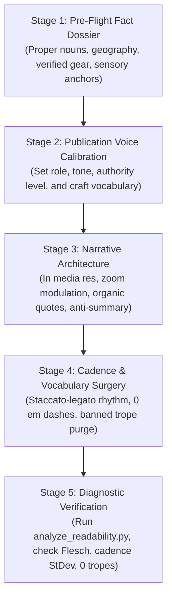

# The Unified Editorial Engine (De-AI Writing)

This skill provides a battle-tested editorial pipeline that transforms generic, formulaic AI text into grounded, scene-driven human writing.

Many other de-ai writing skills focus primarily on shuffling synonyms or inserting conversational slang (*"Honestly,"*, *"To be fair,"*). Real human writing does not sound human because of slang; it sounds human because of **sensory grounding**, **asymmetric rhythmic cadence**, and **narrative tension**.

Whenever asked to write, draft, polish, or humanize content, execute this 5-stage pipeline in order.



---

## Stage 1: Pre-Flight Fact Dossier (Grounding)

**The Law of Concrete Nouns**: Abstract fluff is the AI's fallback defense when it lacks facts. When an LLM does not know the exact street corner, the brand of equipment, or the temperature in the room, it compensates with empty adjectives (*"a vibrant atmosphere filled with passionate artisans"*).

Before writing a single sentence of prose, assemble a **Sensory Dossier**:

1. **Verified Proper Nouns & People**:
   * Identify real founders, organizers, practitioners, or documented subject experts.
   * **STRICT NO-HALLUCINATION GUARDRAIL**: Never invent fictitious human names, artificial author personas, or fake credentials. If no specific individual is verified, attribute content to the organization or editorial publication team (`"<Brand> Editorial Team"`).
2. **Specific Regional Geography**:
   * Highways, exits, intersections, and landmarks (e.g. *I-10 Exit 64*, *Rue de l'Acadie*, *Hwy 190*).
   * Exact administrative divisions: Parishes in Louisiana (never "counties"), boroughs in NYC, natural basins, and waterways.
3. **Physical Hardware & Tools**:
   * Real tools and equipment: single-row diatonic accordion in C, benchtop pH meter with 2-point calibration, induction burner, 5-gallon food-grade HDPE bucket, flat-top dreadnought guitar.
4. **Sensory Anchors**:
   * At least one specific sound (rosin flying off horsehair, swamp cooler hum), smell (cypress mulch, capsaicin steam), and texture (sticky tare buttons, scuffed pine floorboards).

*If you do not have these facts, stop and research first.*

---

## Stage 2: Publication Voice Profiles (Who Is Speaking?)

Every publication carries a distinct human perspective born from lived experience. Calibrate the tone profile to the target audience:

* **Role**: Define who is speaking (e.g., commercial production floor manager, cultural archivist, principal systems architect).
* **Tone**: Pragmatic peer, porch-side observer, unhedged operator.
* **Craft Vocabulary**: Real domain terminology (titratable acidity, water activity, 21 CFR 114, diaphragm pressure, latency budgets).
* **Byline Attribution**: Attribute directly to the verified writer or `<Brand> Editorial Team`.

---

## Stage 3: Narrative Architecture (Breaking the AI Outline)

AI drafts default to a predictable listicle skeleton: *Intro hook -> Heading 1 (3 paragraphs) -> Callout -> Heading 2 (3 paragraphs) -> Quote island -> Robotic conclusion*. Real feature writing modulates between scenes and structure.

### 1. In Media Res Openings (The Sensory Hook)
Never start by explaining what the article is about. Cut the throat-clearing warm-up. Drop the reader directly into physical motion, friction, or sound.
* *AI Default*: *"The Southwest Louisiana Acoustic Cajun Jam is a popular biweekly gathering located at the Gator Chateau in Jennings, Louisiana, providing visitors with authentic culture."*
* *Narrative Hook*: *"Pull off Interstate 10 at Exit 64. The eighteen-wheelers rumble past on the elevated highway, but step onto Rue de l'Acadie and the noise drops away. Rosin flies off horsehair bows under the outdoor pavilion."*

### 2. Zoom Modulation (Scene vs. Summary)
Alternate between two focal lengths:
* **Micro Close-Up**: High sensory immersion, specific physical objects, hands on gear, immediate room atmosphere.
* **Macro Pull-Back**: Historical lineage, regulatory framework, municipal geography, or economic context explaining why the scene matters.
* *Rule*: Follow any dense contextual paragraph with an immediate return to the physical ground. Never float in abstract theory for more than two paragraphs.

### 3. Organic Quote Weaving
Never dump quotes into isolated billboard blocks or repeat monotonous attribution verbs (*"stated Lyon"*, *"explained Dugas"*).
* **Action-Tagged Dialogue**: Weave spoken quotes directly into narrative sentences with physical action tags:
  * *Example*: *Lyon rests the scroll of his fiddle against his collarbone. "If we don't teach the children how to chord," he says, eyes scanning the circle of teenagers, "the tradition disappears into history books."*
* **Grounding Rule**: Only quote real people from verified interviews, broadcast news, or transcripts. Never invent quotes.

### 4. Contrast & Tension
Pair divergent realities to create natural forward momentum:
* 18-wheelers on the interstate vs. acoustic fiddles in a municipal park.
* Cold refrigeration slowing microbes vs. steady pressure buildup in glass bottles.
* Precision digital scale calibration vs. capsaicin mash splashing on rubber boots.

### 5. The Resonant Ending (Kill the "Conclusion")
* **Never write a section titled "Conclusion", "Final Thoughts", or "Wrapping Up".**
* Never summarize what you just wrote.
* End on a **lingering visual detail**, a **sharp human verdict**, or a **parting sensory scene**.

---

## Stage 4: Cadence & Vocabulary Surgery (The Mechanical De-AI)

### 1. Staccato-Legato Cadence (Break the Metronome)
Human writing has musical rhythm. Some thoughts are instant verdicts; others need room to breathe.
* **The Staccato Punch (2 to 6 words)**: *"Don't do it."*, *"Wear the glasses."*, *"Water dilutes heat."*, *"Start low."*, *"That was a mistake."*
* **The Legato Flow (15 to 22 words)**: Operational descriptions explaining mechanics and practical consequences.
* **Paragraph Asymmetry**: Never write two paragraphs in a row with the same sentence count. Follow a 3-sentence descriptive paragraph with a single-line staccato verdict.
* **Cadence Targets**:
  * Sentence Length Standard Deviation: **>= 4.0** (proves healthy variation).
  * Staccato Sentences (<= 6 words): **10% to 25%** of total sentences.
  * Metronome Runs (clusters of 3+ sentences with similar word counts): **<= 2**.

### 2. Absolute Em Dash Prohibition
* **ZERO em dashes (`—` or `--`)**.
* LLMs rely on em dashes to weld disjointed thoughts together and manufacture false conversational flow.
* Use periods, colons, or clean commas. Forcing yourself to write without em dashes exposes run-on thoughts and restores clean sentence architecture.

### 3. Anti-Academic Floor Math
* Write plain inline math: `Formula % = (Ingredient Mass / Total Batch Mass) * 100`.
* **Zero ASCII diagrams** (`[Step 1] --> [Step 2]`). They scream machine generation and overflow mobile screens.
* **Zero raw LaTeX display blocks** (`$$ ... $$`) in conversational or cultural prose.

### 4. The Banned AI Tropes Dictionary

| Banned AI Pattern | Why It Fails | Human / Floor Replacement |
| :--- | :--- | :--- |
| `delve`, `tapestry`, `beacon`, `testament` | AI vocabulary fingerprints | Plain action verbs (*examine*, *mix*, *track*, *build*) |
| `crucial`, `game-changer`, `robust` | Vague corporate buzzwords | Name the specific technical, sonic, or financial benefit |
| *"Behind its [X] lies an unexpected [Y]"* | Formulaic brochure trope | *"Underneath that skin is legitimate [Y]"* |
| *"In today's fast-paced world..."* | Pointless throat-clearing | Cut entirely; open with the action or problem |
| *"Whether you're a novice or seasoned pro"* | Symmetrical filler | Cut entirely; speak directly to the craft practitioner |
| *"Mastering the art and science"* | Corporate marketing cliché | *"Dialing in your batch math"* or *"learning the tunes"* |
| *"Nestled in the heart of..."* | Travel brochure cliché | Name the exact road, parish, or highway intersection |
| *"Rich history"* / *"Treasure trove"* | Lazy tourist guidebook tropes | Cite the specific decade, lineage, or archival record |
| *"It is important to remember that"* | Passive patronizing filler | Cut; state the rule directly as an imperative |

---

## Stage 5: Automated Verification & Diagnostic Testing

Before finalizing or publishing any piece of content, run the automated diagnostic linter:

```bash
python scripts/analyze_readability.py <path-to-markdown-or-text-file>
```

### Quality Gates Checklist:
- [ ] **Flesch Reading Ease**: 50.0 to 85.0 (accessible, conversational to longform reading level).
- [ ] **Flesch-Kincaid Grade Level**: 4.0 to 11.0.
- [ ] **Sentence Length StDev**: $\ge 4.0$.
- [ ] **Staccato Sentences ($\le 6$ words)**: $\ge 10.0\%$.
- [ ] **Metronome Runs**: $\le 2$.
- [ ] **Em Dashes (`—` or `--`)**: Exactly 0.
- [ ] **ASCII Diagrams / Display LaTeX**: Exactly 0.
- [ ] **Banned Tropes**: Exactly 0.
- [ ] **Authorship Integrity**: Byline attributed to `<Brand> Editorial Team` or verified real person; 0 hallucinated personas.
- [ ] **No "Conclusion" Heading**: Article ends on a resonant scene or decisive verdict.
